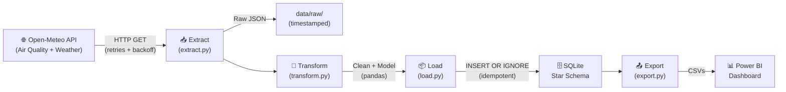
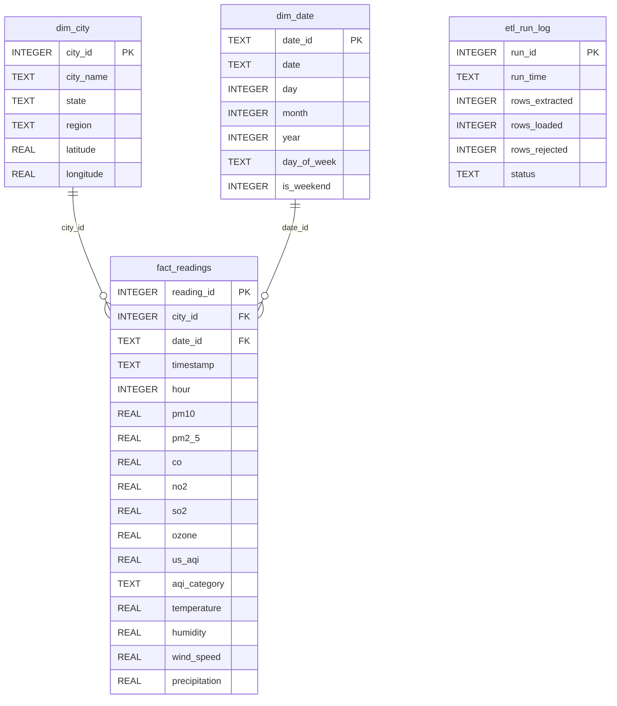

# 🇮🇳 India Air Quality & Weather ETL Pipeline

An automated Python ETL pipeline that pulls **hourly air quality and weather data** for **10 major Indian cities** from the [Open-Meteo API](https://open-meteo.com/) (free, no API key required), cleans and models it into a **star schema in SQLite**, and exports CSVs for **Power BI** dashboarding.

Built as a portfolio project for **Data Analyst / Data Engineer** roles.

---

## 📐 Architecture



---

## 🏙️ Cities Covered

| City | State | Region |
|------|-------|--------|
| Delhi | Delhi | North |
| Mumbai | Maharashtra | West |
| Kolkata | West Bengal | East |
| Chennai | Tamil Nadu | South |
| Bengaluru | Karnataka | South |
| Hyderabad | Telangana | South |
| Ahmedabad | Gujarat | West |
| Pune | Maharashtra | West |
| Jaipur | Rajasthan | North |
| Indore | Madhya Pradesh | Central |

---

## 📂 Project Structure

```
india-aqi-etl/
├── config/cities.json          # City metadata (lat, lon, state, region)
├── src/
│   ├── extract.py              # API calls with retries & backoff
│   ├── transform.py            # Pandas cleaning + star schema modeling
│   ├── load.py                 # SQLite incremental load (INSERT OR IGNORE)
│   ├── export.py               # Export tables → CSV for Power BI
│   └── utils.py                # Logger, config loader, constants
├── data/
│   ├── raw/                    # Raw JSON snapshots (timestamped, gitignored)
│   └── processed/              # CSV exports for Power BI
├── db/aqi.db                   # SQLite database (gitignored)
├── logs/etl.log                # Pipeline log (gitignored)
├── sql/analysis_queries.sql    # 6 analytical queries (CTEs + window funcs)
├── tests/test_etl.py           # 4 pytest tests
├── docs/powerbi_guide.md       # Power BI dashboard build guide
├── run_etl.py                  # Single entry point
├── requirements.txt
├── .gitignore
└── README.md
```

---

## 🗄️ Data Model (Star Schema)



**Key constraints:**
- `UNIQUE (city_id, timestamp)` on `fact_readings` → prevents duplicates
- Indexes on `city_id` and `date_id` for fast joins
- `rejected_rows` quarantine table for data quality audit

---

## ⚙️ Tech Stack

| Layer | Technology |
|-------|-----------|
| Language | Python 3.10+ |
| Data Processing | pandas |
| HTTP Client | requests (urllib3 retries) |
| Database | SQLite |
| Testing | pytest |
| Visualization | Power BI |
| Version Control | Git |

---

## 🚀 Setup & Run

### Prerequisites
- Python 3.10 or later
- Power BI Desktop (optional, for dashboarding)

### Quick Start

```bash
# 1. Clone the repo
git clone <your-repo-url>
cd india-aqi-etl

# 2. Create virtual environment
python -m venv venv

# Windows
venv\Scripts\activate

# macOS/Linux
source venv/bin/activate

# 3. Install dependencies
pip install -r requirements.txt

# 4. Run the ETL pipeline
python run_etl.py

# 5. Run tests
pytest tests/ -v
```

### Output
After a successful run:
- `db/aqi.db` — SQLite database with star schema
- `data/processed/*.csv` — CSVs ready for Power BI
- `data/raw/*.json` — Timestamped raw API snapshots
- `logs/etl.log` — Detailed log file

---

## 🚀 Deployment & Automation

This project supports three deployment methods:

### 1. GitHub Actions CI/CD Pipeline (`.github/workflows/etl.yml`)
The pipeline runs in GitHub Actions:
- **Triggers:** Automatically every hour via cron (`0 * * * *`) and manually via `workflow_dispatch`.
- **Workflow:**
  1. Checks out repository and sets up Python 3.12 with pip caching.
  2. Installs dependencies from `requirements.txt`.
  3. Executes `python run_etl.py` to extract, clean, and incrementally load data.
  4. Runs the automated test suite with `pytest tests/ -v`.
  5. Commits and pushes updated `db/aqi.db` and `data/processed/*.csv` to the repository **only if changes occurred**.

### 2. Interactive Streamlit Web App (`app.py`)
Run the interactive dashboard locally:
```bash
streamlit run app.py
```
- **Live KPIs:** Overall and city-specific Avg AQI, Avg PM2.5, % Unhealthy+ hours, Max AQI, Total Records.
- **Dynamic City Comparison Bar Chart:** Benchmark comparison across all 10 cities; selecting a city in the dropdown highlights its bar in accent blue (`#0ea5e9`) and dims the other 9 bars.
- **EPA Category Donut:** Distribution across Good, Moderate, Unhealthy for Sensitive Groups, Unhealthy, Very Unhealthy, and Hazardous.
- **48-Hour Hourly Trend:** Restricted to timestamps up to the current hour in `Asia/Kolkata` timezone.
- **Temperature vs PM2.5 Scatter:** Plotly scatter chart with interactive EPA category legend and correlation subtitle.
- **Prebuilt SQL Analysis:** Dropdown to run and inspect all 6 CTE & Window function queries in real time (read-only).
- **ETL Audit Table:** Displays recent pipeline run history from `etl_run_log`.

### 3. Local Windows Task Scheduler
Schedule automated hourly runs in Windows:
```powershell
$action = New-ScheduledTaskAction -Execute "venv\Scripts\python.exe" -Argument "run_etl.py" -WorkingDirectory "C:\path\to\india-aqi-etl"
$trigger = New-ScheduledTaskTrigger -Once -At (Get-Date) -RepetitionInterval (New-TimeSpan -Hours 1)
Register-ScheduledTask -Action $action -Trigger $trigger -TaskName "IndiaAQI_ETL" -Description "Hourly India AQI ETL pipeline"
```

---

## 🔄 Scheduling (Hourly Runs)

### Linux/macOS Cron

```bash
# Edit crontab
crontab -e

# Add this line (runs every hour at minute 0):
0 * * * * cd /path/to/india-aqi-etl && venv/bin/python run_etl.py >> logs/cron.log 2>&1
```

---

## 📊 Power BI Dashboard

See **[docs/powerbi_guide.md](docs/powerbi_guide.md)** for step-by-step instructions to:
1. Import the 3 CSVs
2. Set up star schema relationships
3. Create DAX measures (Avg AQI, % Poor Hours, etc.)
4. Build dashboard visuals (KPI cards, bar charts, maps, scatter plots)

---

## 🔍 SQL Analysis

The file `sql/analysis_queries.sql` contains 6 analytical queries:

| # | Query | Techniques |
|---|-------|-----------|
| 1 | Average AQI by city (ranked) | `GROUP BY`, `RANK()` |
| 2 | Worst 5 hours per city (exactly 5/city) | CTE, `ROW_NUMBER()`, `PARTITION BY` |
| 3 | 24-hour moving average of PM2.5 | `AVG() OVER (ROWS BETWEEN)` |
| 4 | Day-over-day AQI change | CTE, `LAG()` |
| 5 | % hours in Unhealthy or worse (US EPA) | `CASE`, aggregate |
| 6 | Weekday vs Weekend comparison | CTE, `CASE` |

---

## 💡 Key Insights (from 7-Day Live Run)

Based on 1,920 hourly readings extracted across all 10 cities:
- **Most Polluted Cities:** Kolkata (199.8 avg AQI, 118.7 µg/m³ PM2.5) and Delhi (189.1 avg AQI, 102.8 µg/m³ PM2.5) topped pollution rankings, spending **84.9%** and **99.5%** of all hours in *Unhealthy* or worse categories (US EPA standard). Mumbai followed with 179.4 avg AQI (87.0% Unhealthy+ hours).
- **Cleanest Air:** Bengaluru recorded the lowest average AQI (107.0, 38.0 µg/m³ PM2.5) with **0.0%** of hours in the Unhealthy or worse tier, followed by Chennai (115.7 avg AQI) and Ahmedabad (119.6 avg AQI).
- **Weekend Effect:** In tech-centric Bengaluru, average AQI dropped significantly from **114.5 (Weekday)** to **84.5 (Weekend)**, a 30-point drop reflecting traffic reduction. Conversely, Ahmedabad experienced higher weekend pollution (132.9 weekend vs 115.1 weekday).
- **Diurnal Peaks:** PM2.5 and PM10 consistently peak during morning (08:00–10:00) and evening rush hours (19:00–22:00) across northern and eastern plains.

---

## 📸 Screenshots *(placeholder)*

> Add screenshots of:
> - Terminal output from a successful ETL run
> - Power BI dashboard
> - SQLite schema in DB Browser

---

## 🔮 Future Improvements

| Improvement | Description |
|-------------|-------------|
| **Apache Airflow** | Replace cron/Task Scheduler with a proper DAG-based orchestrator |
| **dbt** | Use dbt for SQL transformations and testing |
| **Cloud Warehouse** | Migrate from SQLite to BigQuery, Snowflake, or PostgreSQL |
| **Docker** | Containerize the pipeline for portability |
| **Data Quality** | Add Great Expectations for more comprehensive validation |
| **Historical Backfill** | Use `start_date`/`end_date` params to load months of history |
| **Alerts** | Email/Slack notifications when AQI exceeds thresholds |
| **CI/CD** | GitHub Actions for automated testing on push |

---

## 📄 License

This project is for educational and portfolio purposes. Data sourced from [Open-Meteo](https://open-meteo.com/) under their free-use terms.
